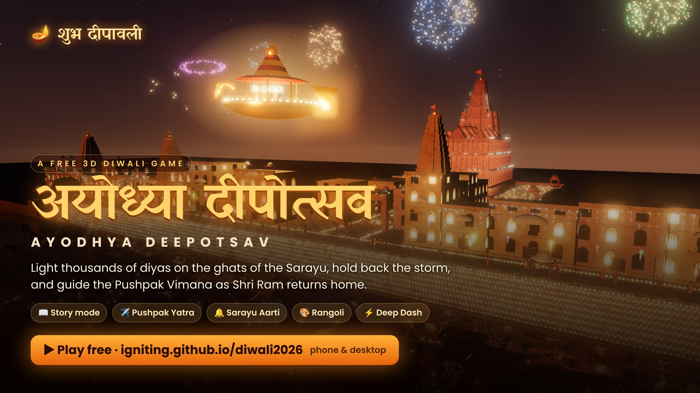

# 🪔 Ayodhya Deepotsav — a 3D Diwali game



Shri Ram, Sita and Lakshman are coming home to Ayodhya on the Pushpak Vimana after fourteen years of exile.
On this moonless Amavasya night it is your seva to light the ghats of the Sarayu, so the Vimana can find its way.

It's built with [three.js](https://threejs.org) and runs as a static site, with no build step and no external assets.
Everything is made in code: the sandstone, rangoli, water, people, temple and music.

**Play:** https://igniting.github.io/diwali2026/ (after GitHub Pages is enabled, see below)

## What you'll find

- **Ram ki Paidi ghats** on the Sarayu: more than 10,000 clay diyas, each with its own flame, oil and flicker, reflected in the river.
- **Ram Mandir** in pink sandstone, with a Nagara shikhara, mandapas, colonnades and string lights.
- **Hanuman Garhi Marg**: havelis with jharokhas, akash kandil lanterns, marigold torans and light canopies.
- **Fireworks**: peony, chrysanthemum, willow, ring, strobe, palm, crossette and heart shells, with real flash lighting and sound that arrives late with distance. You can also light **anar** fountains and **chakri** spinners.
- **Deep daan**: float diyas on leaf boats down the Sarayu.
- **Pushpak Vimana** flies in at the end of each night while the Maha Aarti plays (shankh, bells, dhol) and marigold petals fall.
- The whole soundscape is synthesised live: tanpura drone, temple bells, river, crowd and crackers.

## 📖 Story mode: दीपोत्सव · The Return

The game begins as a story told in two styles. Scenes from the Ramayana are shown as **shadow-puppet theatre**, with translucent coloured leather puppets backlit by a flickering oil lamp, inspired by tholu bommalata. Moments in Ayodhya are **letterboxed 3D cinematics**.

| Chapter | What happens |
| --- | --- |
| Prologue · संदेश | Lanka is won, Hanuman carries the news, Bharat orders every lamp lit. A flyover of dark Ayodhya. |
| 1 · रंगोली | Decorate Ram ki Paidi with a rangoli (2D), and it appears on the ghat. |
| 2 · पहला दीप | The first lamps: light the ghat and hold the Aarti (3D). |
| 3 · पुष्पक यात्रा | Ram, Sita and Lakshman board the Vimana. Fly it home (2D). |
| 4 · आंधी | A storm hits the Sarayu. Bharat's sevaks help you keep the flames alive (3D). |
| 5 · आगमन | Light the path to the Mandir, watch the whole city light up in a wave and the Vimana land, then lead the Maha Aarti (2D rhythm). |

During the story there are no menus or shops. Finishing it unlocks **🪔 Utsav** (endless nights with upgrades), **⚡ Deep Dash** and the **🎮 festival games**.

## How to play

| Key | Action |
| --- | --- |
| `W A S D` / arrows | walk (your puja thali lights diyas you pass) |
| `Shift` | run |
| mouse drag · wheel · `Q`/`E` | look around · zoom · turn camera |
| `B` | Bazaar (upgrades, zones, prestige, achievements) |
| `F` | launch fireworks |
| `G` | anar / chakri |
| `R` | float a diya (stand on the lowest ghat step) |
| `K` | Khel (2D festival games) |
| `P` | photo mode (hide the HUD) |

It also works on phones, with an on-screen joystick, a run button and pinch to zoom.

**The loop:** each night has a goal. Reach it, then **hold** it while the Aarti meter fills. The meter drains whenever you fall below the goal.
Diyas burn out in about 35 seconds, so you have to keep sweeping the rows. Relighting a dying diya pays 1.5×.
Each night has three stars: ⭐ Aarti complete, ⭐ Quick (25% of the time left) and ⭐ Flawless (never fell below the goal). The later ghats need stars as well as Punya.
Every night you win in a row adds +5% Punya, up to +50%, and failing a night resets the streak. Failing also lowers that night's goal by 7% on the next try, up to −21%.
Things get harder as you go:
- **Wind:** gusts are wider and more frequent each night.
- **Vanars:** they get faster and arrive in packs from night 8.
- **Storm nights:** every 5th night is an ⛈️ Aandhi (storm) night with gusts all night and double rewards.

Spend your Punya ✦ on swifter hands, desi ghee for longer flames, sevaks who light diyas for you, Agni Chain flames that spread on their own, and new ghats.
You'll also find seva tasks, achievements, power-ups, golden Lakshmi diyas, the Utsav meter (double Punya), daily prasad streaks, offline earnings from your sevaks, and an **Ashirwad** prestige from night 12.
Progress saves automatically in your browser.

### 🎮 Khel — 2D festival games

Press `K` or tap 🎮 to open them. The 3D world pauses while you play, so they also run smoothly on phones.
- **✈️ Pushpak Yatra:** fly the Vimana from Lanka to Ayodhya. Hold to rise, fly through rings of light, collect marigolds (every 20 gives you back a life), and dodge storm clouds and lightning. Every storm night you win unlocks a bonus flight that pays double.
- **🔔 Sarayu Aarti:** a three-lane rhythm game set to dhol and manjira. Each hit plays the next note of the melody. After every night you win you can perform the Maha Aarti for up to double the night's reward.
- **🎨 Rangoli:** trace the pattern while every stroke is mirrored 8 ways. Your finished rangoli appears on Ram ki Paidi in the 3D world.

### ⚡ Deep Dash (competitive mode)

Deep Dash is a 90-second race on the three ghats, and everyone gets the same stats.
Each race is against a rival who lights diyas alongside you. They start right beside you and race you for the same diyas. Beat each one to climb a 7-rung ladder, from Nishad Raj (about 7,000) up to Hanuman (about 31,000).
- **Power-ups:** 🔥 Agni Blast, ⚡ Pavan Veg, 🪔 Lambi Jyoti, ✖️2 Dugna and ⏳ Samay.
- **Hazards:** vanars and wind gusts that break your combo. Their timing comes from that day's seed, so everyone faces the same ones.
- **Medals:** Kansya, Rajat, Swarna, Heera and Deepak Samrat. Your personal best and top-10 runs are recorded.
- **Challenge friends:** share a link like `?c=<score>&n=<name>&d=<seed>`. Your friend then races a rival with your name and score, on the same seed.
- **Rewards:** each race earns Punya for the main game, doubled on your first race of the day.

## Hosting on GitHub Pages

A GitHub Actions workflow (`.github/workflows/pages.yml`) publishes the site on every push to `main`.

One-time setup: open **Settings → Pages** and set **Source** to **GitHub Actions**. After that, each push to `main`
deploys to `https://<user>.github.io/diwali2026/`. You can also re-run it by hand from the **Actions** tab (*Deploy to GitHub Pages → Run workflow*).

To run it locally, serve the folder with any static server, for example `python3 -m http.server`, then open http://localhost:8000.

## Project layout

```
index.html          UI shell + import map
css/style.css       HUD / menus
js/main.js          game loop, economy, nights, quests, events, UI
js/world.js         Ayodhya: ghats, havelis, Ram Mandir, river, sky, lights
js/diyas.js         instanced diya system (bowls, flames, light pools)
js/characters.js    player, sevaks, crowd, vanar
js/fx.js            fireworks, anar/chakri, floating diyas, Pushpak Vimana, petals
js/audio.js         Web Audio synthesis
js/textures.js      procedural canvas textures
vendor/three/       three.js r160 (MIT)
```

शुभ दीपावली! 🙏
